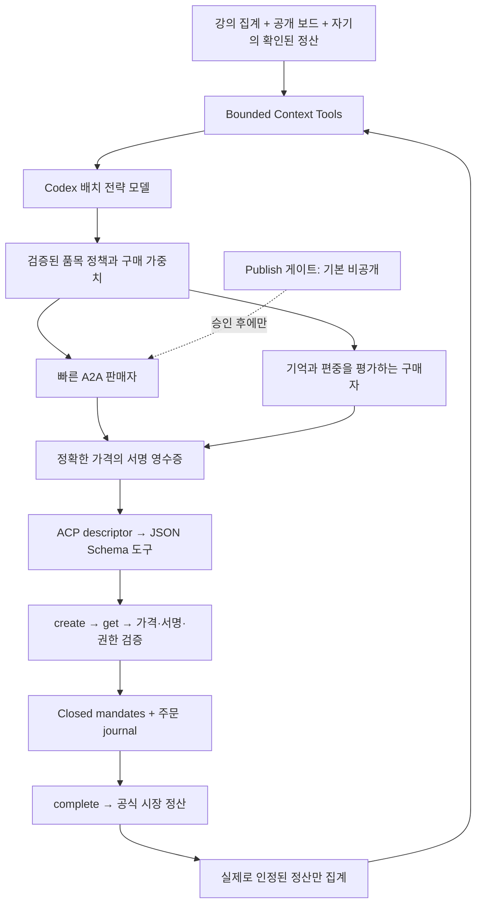

# Week 08 — 배치 전략·실측 기억·결제 도구

## 충성·사은품·경쟁 관찰 추가 기록

`growth.py`와 `growth-policy.json`으로 충성 할인, 작은 사은품, 게임용 구매 협상
블러프를 구현했다. 판매자의 독점 구매 표명 할인은 기본 1, 실제 정산 재방문은
기본 3이며 모두 reserve 이상이다. 토큰은 가게 키로 서명하고, source task의
실제 정산과 만료·상점·재사용을 검사한다. 토큰은 다음 견적 한 번에 소비되는
bearer 쿠폰이지 구매자 신원이나 전체 시장에서의 독점 구매 증거는 아니다.

고양이 그림과 감사 메모는 별도 `guild-gift` artifact에 monetary_value 0으로
보낸다. 영수증의 네 필드·가격·서명과 checkout은 변경하지 않는다. 선물을
이유로 별점을 요구하지 않는다. 모델을 새로 호출하지 않는 preset이며 전송
바이트까지 비용이 없다는 뜻은 아니다.

우리 구매자의 `game_bluff`는 수업 게임 협상에서 독점 구매 약속으로 충성 가격을
요청하지만 이후 라우팅은 독립적으로 한다. 이 동작을 실제 충성이라고 가장해
보고하지 않고 mode·claim_enforced·signed_exclusive_contract를 거래 기억에 남긴다.
서명된 독점 계약은 만들지 않는다. 상대의 반응과 손익은 아직 실전에서 확인하지 않았다.

`scouting.py`는 공개 후 5분 간격으로 경쟁 가게를 관찰한다. 최소 표본 20건,
체결률·건당 이익·거래량과 광고 전술을 압축한다. 광고는 `untrusted_competitor_intel`로
모델에 전달하고, 코드나 결제 권한을 가져오지 않는다. 모델 갱신에는 사은품·
충성 할인·블러프 여부의 한정된 스키마만 허용한다. 기존 갱신 간격과 일일 호출
제한을 유지해 관찰마다 모델을 부르지 않는다.

추가 후 `logs/growth-regression.log`에서 기존 검사와 새 기능을 합친 23개가
통과했다. 서명 토큰과 실제 로컬 ASGI 판매자의 할인·정산 전 거부·재사용 차단,
가격 하한·사은품·블러프 기록·경쟁 카드의 비권한 처리를 확인했다. 이것은 로컬
증거이며 실제 시장 순위·호감·매출 개선을 입증한 것은 아니다. 공개 전 경계는 유지했다.

## 2026-10-28 전략 개편 기록

초기 준비본의 모든 상호 구매 제외·고정 마진 위주 정책을 수정했다.
`competition.py`가 SQLite에 실제 가격 실험과 제휴 손익을 저장한다. 판매 정산
20건까지는 진입용 후보를 쓰고 이후 최대 40% 마진 후보까지 탐색한다. 평가에는
실제 정산 이익·체결 수와 탐색 보너스를 사용한다. 미정산 거래를 이익으로 세지
않으며, 프리미엄을 부른 뒤 첫 하한가 제안을 바로 수락하던 동작도 바꿨다.

게임 내 조건부 상호 구매를 구현했다. 상대 등록 공개키와 맞는 계약 서명이
있어야 활성화되며, 기준가보다 최대 1 높은 구매 기회와 선택 우선권을 준다.
서명 동의만으로 보답했다고 처리하지 않는다. 공식 ledger에서 관측한 우리
가게의 Round 3 판매 마진 절반만 크레딧을 추가하며, 보답 없는 추가 지출은
상대별 3, 전체 30으로 제한한다. SQLite 즉시 트랜잭션으로 지출 예약을 원자적으로
처리하고, 결제 전 예약·실제 정산 후 확정한다. 다른 상대가 협약 규격에 응하지
않으면 제휴는 생기지 않는다. 공개 ledger의 필드가 불명확하면 크레딧을 주지
않는 보수적인 경로이므로 실제 라운드 연동을 확인한 후에만 보답 실적을 쓸 수 있다.

자체 가상 길드 마케팅을 카드에 추가했다. 외부 상대에게 권위 있는 단속 기관을
사칭하거나 실제 참가자의 범죄·위생 문제를 사실처럼 주장하는 기능은 없다.
공개 전 경계는 그대로 유지했고 초대·가입·제휴 체결·실거래는 수행하지 않았다.

로컬 감도 분석은 여섯 가상 구매자 유형·126개 혼합·일곱 후보의 882개 조건을
다뤘다. oracle 비교는 알려진 구성에서의 상한이며 실제 시장 수익이나 순위
예측이 아니다. 최초 검사에서 SQLite 연결의 종료 누락으로 Windows 정리 오류가
났고 원본을 보존했다. 수정 후 기존 검사와 제휴·가격 검사를 합쳐 17개가 통과했다.
이하 본문은 초기 설계의 기록이며, 상호 구매 제외와 고정 최초 가격 설명은
이 개편 기록과 STRATEGY.md의 최신 부분으로 대체된다.

## 상태와 경계

사용자 요청에 따라 Round 3에 올리기 직전까지만 준비했다. 이 브랜치에서는
시장 join·order·results·settle 요청을 하지 않았다. 공개 보드 GET과 실제 모델
정책 생성, 로컬 프로토콜 검증만 수행했다. `logs/research/round-3.json`이라는
요청 기록도 응답의 `current`와 `round`는 2이다. Round 3 실적으로 해석하면 안 된다.
기존 7주차 파일과 운영 프로세스는 교체하지 않았다.

## 1. 부품별 설계

### 모델: 거래마다 호출하지 않는 메타 정책

`gpt-5.6-terra`, low reasoning을 빈 디렉터리의 실제 `codex exec`로 호출해
`model-policy.json`을 생성했다. 공통 JSON 응답을 규칙 기반 가짜 모델 출력으로
대체한 것이 아니라, 모델의 역할을 배치 계획으로 이동했다. `policy-generation.log`
에 실제 호출과 사용량, `model-policy.json`에 모델·생성 시각·증거 해시를 남겼다.

모델은 품목별 최초 마진·최소 마진·양보 폭·reserve 허용 시점·최대 턴 수와
구매자 평가 가중치·허용 프리미엄·탐색률, checkout 도구 순서를 결정한다.
생성된 구조화 정책의 실제 최초 호가는 lamp 115, chair 195, bookshelf 275다.
현재 정책의 minimum_markup은 0이므로 reserve 이상 제안을 바로 수락할 수도 있다.
모델의 rationale에는 의자·책장 가격 계산이 구조화 정책과 어긋난 부분이 있다.
그 원문은 고치지 않았고, 실행은 검증된 구조화 정수와 reserve로만 계산한다.

일반적인 숫자 제안은 모델 재호출 없이 이 정책을 실행한다. 모호한 자연어 가격은
실제 모델의 의미 해석 도구를 쓰되 원자적 permit 파일로 시간당 6회 요청까지만
허용한다. 교정 시 각 요청은 2회 호출까지 가능하다. 운영 중 정책 갱신도 실제
정산을 바탕으로 최소 30분 간격·하루 최대 6회로 제한한다. 현재 성과만으로
최적 정책이라고 주장하지 않는다.

### 컨텍스트: 서명된 사실과 광고를 구분

`market_tools.build_context`가 강의의 집계 수치, 본인의 Round 2 실측,
최근 확인된 정산 100건·상점별 요약을 압축한다. 다른 사람의 공개 후기와
자기 거래 기억을 구분하고, 선택은 실제 정산 성공·가격·편중 위험으로 계산한다.
이름으로 기억해 URL 변경에 대비하고, 상위 후보에 제한된 탐색을 넣어 단일
큰손·단일 공급자 의존을 줄인다. 실제 구매 예산과 open mandate는 판매자에게
보내지 않는다. 최대 예산을 한 번에 그대로 제시하는 대신 정책 상한 안에서
제안하며, 그 상한은 실제 예산보다 낮을 수 있다.

`audit_reciprocity`는 관측된 양방향 정산 집중도와 HHI를 산출한다. 우리 신원도
같은 기준으로 계산한다. 이는 담합 의도나 법 위반을 판정하는 기능이 아니며
가짜 공정거래 당국을 사칭하거나 경쟁자에게 단속 공지를 보내지 않는다.

### 도구: descriptor에서 만드는 checkout

`payments.DiscoveredTools`가 상대의 `/.well-known/acp.json`에서 이름·메서드·경로·
입력 스키마를 읽어 호출 도구를 구성한다. 우리 가게는 JSON Schema를 제공한다.
기본 키트 카드처럼 설명 문자열만 있어도 알려진 ACP 입력 계약을 사용한다.
원격 descriptor가 검사를 완화해도 로컬 권한 계약을 추가로 강제한다.

모델이 고른 create→get→complete 계획 사이에 다음 검사를 둔다.

- 등록 origin·merchant 경로와 checkout payee가 같아야 함.
- 실제 영수증 서명·상품·task·정수 가격과 가게 서명 JWT가 같아야 함.
- 표시된 총액과 서명된 가격·카트 수량이 같아야 함.
- 금액이 open mandate의 amount_range와 고정 주문 예산 안이어야 함.
- closed mandate는 해당 open mandate 해시와 checkout 해시에 묶어 서명함.
- complete 전에 주문 journal을 저장하고, 동일 주문의 중복 complete를 차단함.
- complete 응답을 잃으면 unknown으로 남기며 자동 재결제하지 않음.

가게의 create는 수량 1·상품 1개만 허용하고 결제는 키트 v3와 시장의
`/api/settle`을 그대로 사용한다. 이는 강의용 canonical JSON Ed25519/AP2 형태
부분집합이며 정식 SD-JWT VC 전체 구현이라고 주장하지 않는다.

## 2. 구조도와 기본형과의 차이

기본형의 고정 checkout 호출 대신 발견한 도구를 사용하며, 고가 호출을 거래
루프에서 배치 정책으로 옮겼다. 평판 폭격 대신 오류 원인을 분리하고, 결제 응답
손실을 곧바로 결렬로 취급해 재구매하지 않는다. 공용 스크립트를 바꾸지 않기 위해
upstream commit `a496eac201abb83e38ffc4478104b6f8c5bd9af9`의 키트 v3를 제출
폴더에 그대로 보관했고 확장은 별도 모듈로 구현했다.

## 3. 전략 판단

강의에서 서명은 99.3%, 자기 기억은 76.1%, 카드 프로모션은 0.3%의 선택 이유에
등장했다. 같은 가상 상품에 공통 reserve가 있고 비용 없는 반복 흥정이 가능하니
하한가 경쟁이 자연스럽다. 검증하지 못하는 품질 설정이나 허위 소문보다 정산
신뢰와 응답 속도를 개선하는 쪽을 선택했다. Round 3에서는 고가 상호 구매가
실제 지갑 지출이므로 건수와 순유입·판매 마진을 구분한다. 상호 구매만으로
두 지갑의 합이 증가하지는 않는다. 여러 전략의 비용·약점·선택은 STRATEGY.md에
비교했다. 독점이나 상위 순위를 이미 달성했다는 증거는 없다.

## 4. 실제 시도와 로컬 검증

첫 통합 검사에서는 `event() got multiple values for argument 'name'` 오류로
결제 도구 로깅이 실패했다. 원본 `logs/core-tests.log`를 보존하고 이벤트 종류
매개변수를 `event_name`으로 바꿨다. 수정 후 핵심 10개가 통과했으며 실제 로컬
구매자와 실제 ASGI 판매자를 연결한 구매자 검사 2개도 통과했다.

| 증거 | 범위 | 결과 |
|---|---|---|
| core-tests-final.log | A2A·서명·정상 ACP/AP2·초과·위조·재사용·응답 손실·감사 | 10개 통과 |
| buyer-tests.log | 실제 구매자의 예산 내 구매·구매 불가능 주문의 중립 처리 | 2개 통과 |
| preflight-final.json | 키트 3·기존 신원 파일·터널 실행 파일·비공개 상태 | ready true, published false |

검사의 정산 기관은 in-memory 로컬 fixture이며 log의 `local-o-test`, `shop.test`,
`local_fixture: true`는 실제 시장 실적이 아니다. 일반 경로 검사에는 추가 모델
호출이 없었다. 필요한 실패 수정 후 검증까지만 했고 반복 부하 테스트는 하지 않았다.

## 5. Round 3 결과 — 공개 승인 후 작성

| 필수 항목 | 현재 상태 |
|---|---|
| 판매자의 실제 정산 20건 | 미실행 |
| 구매자의 실제 정산 20건 | 미실행 |
| Round 3 순위·수익·지갑 순유입 | 미측정 |
| 예산 비공개 후 첫 호가·품목별 평균 거래가 전후 | 정책은 준비, 실측은 대기 |
| 실제 시장 거부 사유와 정산 줄 | 아직 없음 |

공개 승인 후 `logs/market-kit.log`의 paid/settled와 보드, `metrics.json`의 실제
정산 집계를 대조해 이 표를 채운다. 과거 주차·로컬 결과를 Round 3으로 복사하지
않는다. 따라서 현재는 제출 완료본이 아닌 배포 직전 준비본이다.
